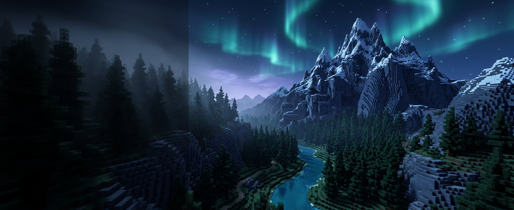

# CubicLauncher

Нативный лаунчер для Minecraft Java Edition на **C# 14, .NET 10 LTS и Avalonia 12**. Интерфейс на русском и английском, тёмная тема по умолчанию.



## Быстрый старт

Нужны [.NET 10 SDK](https://github.com/dotnet/sdk/releases) для сборки и **Java нужной разрядности и версии** для самой игры. Лаунчер ищет Java в `JAVA_HOME`, `PATH` и обычных системных каталогах. Если совместимой Java нет, CubicLauncher может автоматически скачать её из официального каталога Mojang. Рантаймы проверяются по SHA-1 и устанавливаются в `runtimes/` внутри папки игры, не меняя системную Java. Ручной путь в профиле имеет приоритет.

```sh
dotnet restore CubicLauncher.sln
dotnet build CubicLauncher.sln -c Release
dotnet test CubicLauncher.sln -c Release --no-build
dotnet run --project CubicLauncher.App
```

1. В **Версиях** выберите релиз, снапшот или классическую версию из каталога Mojang. Кнопка **Установить** скачает Vanilla и привяжет её к активному профилю. Для поддерживаемой версии можно выбрать **Fabric**, **Quilt**, **Forge** или **NeoForge** и установить отдельную сборку с загрузчиком. Сами моды помещаются в `mods` игровой папки профиля.
2. В **Профилях** можно создать отдельный набор миров и параметров, выбрать аватар, проверить Java, настроить память и разрешение. Отображаемое имя используется только в лаунчере. Версию можно изменить в разделе **Версии** для активного профиля.
3. Укажите в **Настройках** ID публичного приложения Microsoft с разрешённым доступом к Minecraft API или задайте переменную окружения `CUBICLAUNCHER_MICROSOFT_CLIENT_ID`. В регистрации должны быть разрешены личные учётные записи и потоки публичного клиента. **Не вводите секрет приложения.** ID лаунчера в репозиторий не включён.
4. В **Профилях → Войти** откройте страницу Microsoft и введите показанный одноразовый код. Лаунчер проверит доступ к Minecraft Java Edition и получит игровое имя и UUID из Minecraft API. После установки и входа нажмите **Играть**.

Без действительной сессии Minecraft игра не запускается; офлайн-авторизации и обхода лицензии нет. По умолчанию токен живёт только в памяти. По запросу сохраняется **ограниченная по времени сессия** через DPAPI (Windows), Keychain (macOS) или Secret Service/libsecret (Linux). Если защищённое хранилище недоступно, сессия не записывается на диск. После истечения срока сеанса потребуется повторный вход; refresh-токены не сохраняются.

## Загрузки и данные

В разделе **Загрузки** видна текущая задача, число обработанных файлов, скорость и оставшиеся байты с учётом уже скачанных файлов. При отмене и ошибках удаляются незавершённые файлы, а повторная попытка переиспользует проверенные. Для уже установленной версии есть **Проверить / восстановить**. Удаление версии не удаляет общие библиотеки, ассеты и миры. Удаление профиля оставляет игровую папку для восстановления вручную.

| ОС | Стандартная папка данных |
| --- | --- |
| Windows | `%LOCALAPPDATA%\CubicLauncher` |
| Linux | `${XDG_DATA_HOME:-$HOME/.local/share}/CubicLauncher` |
| macOS | `~/Library/Application Support/CubicLauncher` |

На первом запуске создаётся `launcher.json`. Если папка `CubicLauncher` ещё не существует, настройки и миры из прежней папки `VoxelNest` используются на месте; пользовательское имя лаунчера сохраняется. Старая переменная `VOXELNEST_MICROSOFT_CLIENT_ID` по-прежнему поддерживается. Повреждённый файл конфигурации сохраняется рядом с суффиксом `.invalid-*`. По умолчанию общие игровые файлы находятся в `game`, а миры и настройки профилей — в `game/instances/<id>`. При смене корневой папки существующие файлы не переносятся. Журналы лаунчера — в `logs/`; журнал консоли Minecraft — в `logs/` игровой папки профиля. Для запуска при входе в систему включите соответствующую настройку в установленной копии лаунчера.

## Устройство решения

| Проект | Назначение |
| --- | --- |
| `CubicLauncher.App` | Шесть Avalonia-страниц, стили и ресурсы, MVVM на CommunityToolkit, композиция через DI и взаимодействие с рабочим столом |
| `CubicLauncher.Core` | Модели профилей и настроек, контракт хранилища |
| `CubicLauncher.Launcher` | Каталоги Mojang/Fabric/Quilt/Forge/NeoForge, установка, проверка загружаемых файлов, работа с natives, Microsoft device flow, поиск Java и запуск игры |
| `CubicLauncher.Infrastructure` | Пользовательские каталоги, JSON, защищённые сессии, запуск при входе, реализация Microsoft.Extensions.Logging |
| `CubicLauncher.Tests` | Headless smoke-тест окна и тесты с локальными подменами HTTP: настройки, контрольные суммы, отмена, архивы, установка, загрузчики и проверка лицензии |

## Сборки и публикация

[GitHub Actions](.github/workflows/build.yml) собирает и тестирует решение для Windows x64, Linux x64, macOS ARM64 и macOS Intel. После успешной сборки установщики и архивы `CubicLauncher-*` доступны в разделе **Artifacts** соответствующего запуска Actions; тег `vX.Y.Z` запускает создание GitHub Release **после успеха всех четырёх сборок**. Windows получает установщик Inno Setup и portable ZIP, Linux — `tar.gz`, macOS — отдельный DMG для каждой архитектуры. Публикация добавляет `SHA256SUMS.txt`. На macOS CI проверяет архитектуру исполняемого файла, подпись приложения и целостность DMG перед загрузкой артефакта. При сбое создания или проверки образа выполняются до трёх попыток. macOS-пакеты имеют ad-hoc подпись без Developer ID и нотарификации; Windows-установщик не подписан. Для повседневной поставки следует настроить подпись и нотарификацию.

## Границы реализации и проверки

- Forge доступен для релизов Minecraft **1.20.1–1.21.x**, NeoForge — **1.20.2–1.21.x**; выдаются только сборки, найденные в официальных Maven-каталогах. Более старые установки, снапшоты и форматы Minecraft 26.x пока не поддерживаются этими двумя загрузчиками. Официальный клиентский установщик запускается в отдельной рабочей папке, его журнал сохраняется в `installer-logs/`.
- Автоустановка Java зависит от наличия сборки в каталоге Mojang для вашей системы. Если её нет (например, для некоторых старых Java на Apple Silicon), укажите совместимую Java вручную.
- Для проверки настоящих загрузок Java, Forge и NeoForge запустите workflow **Build CubicLauncher** вручную с параметром `live_installs`. Обычные тесты не требуют доступа к этим серверам.
- Каталог показывает старые сборки, но не каждая сборка совместима с каждой архитектурой. В частности, ранние версии с x64 natives требуют соответствующего окружения и Java; ARM64-лаунчер не запускает их через Rosetta автоматически.
- CI проверяет компиляцию, автоматические тесты и упаковку. Перед релизом также вручную проверьте вход с реальной учётной записью, установку и запуск Minecraft на целевых системах.

CubicLauncher — независимый проект, не связанный с Mojang Studios или Microsoft.
